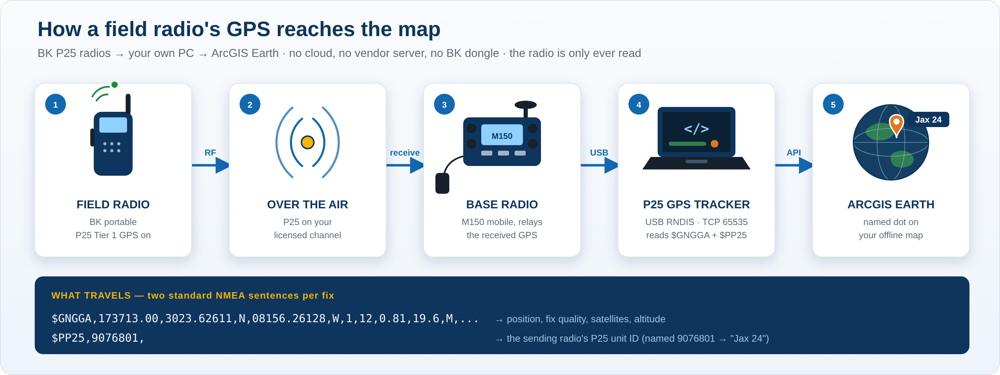
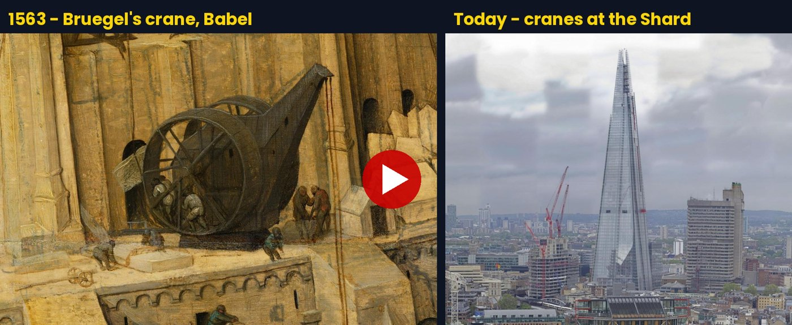
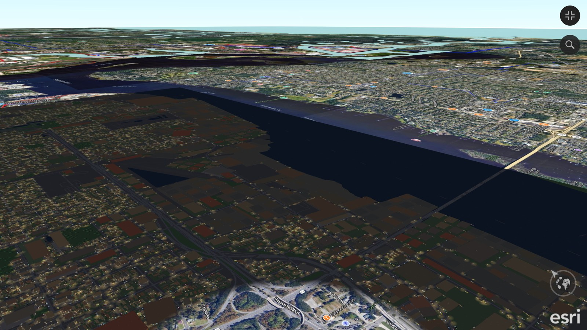
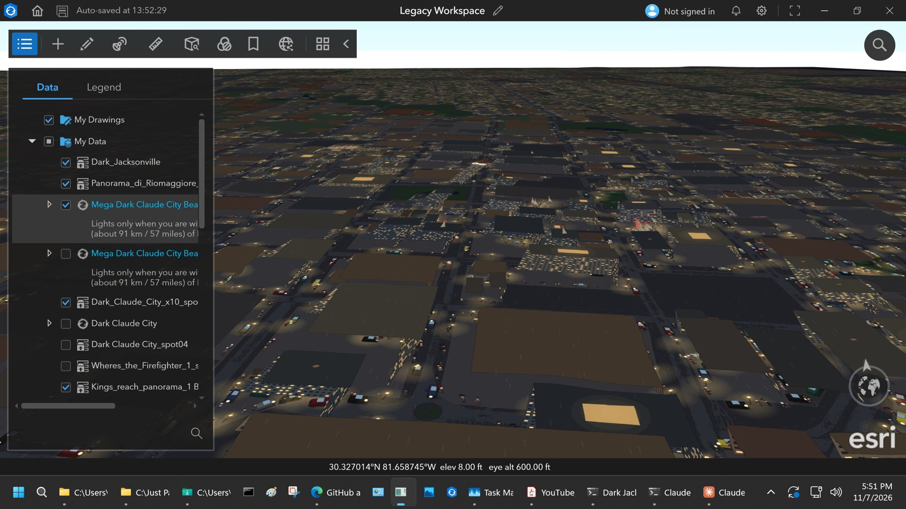

# ArcGIS Earth Unlocked

**ArcGIS Earth has no offline map-making pipeline, no joystick flight, no way to travel city to city, no easy object authoring and no picture worlds.**

Free Windows tools for building offline maps, flying the map with a joystick, adding parcels, hydrants and other public data, placing your own objects, and tracking units live, all inside **ArcGIS Earth**.

> 🤖 **Using AI assistance?** Have the agent read the [CLAUDE.md](CLAUDE.md) file first.

## **📦 [Download the Whole ArcGIS Earth Unlocked Series of Tools - all 10 in one zip](https://github.com/Jim-dc95811/ArcGIS-Earth-Unlocked/raw/main/downloads/ArcGIS_Earth_Unlocked_All_Tools.zip)**

Every tool, at its latest version, in one zip (about 0.4 MB): Extract All and you get one folder per tool, each with its one `.bat` to double-click. Each `.bat` gets the PC ready first - it installs Python for you if it is missing (answer **Y**, no admin needed). The ArcGIS Pro Batch Factory add-in is not in it (it needs ArcGIS Pro) - get it from its own link under Download the tools.

[![The 10 tools in action: 1 MBTiles converter - QGIS maps offline in ArcGIS Earth; 2 Master 4 Grid Maker - 100 numbered map cells; 3 PRAVE / ME Tracker - radio units live on the map; 4 PRAVE / RMC Tester - bench test without a radio; 5 EarthStick - fly the world with a joystick; 6 World Gate Maker - your own gates, city to city; 7 Object Factory - beacons and objects in the sky; 8 PointLayer - hydrants and public points offline; 9 Parcel100 - click a parcel for owner and address; 10 Picture World Maker - fly into giant pictures](images/ten_tools_montage.jpg)](images/ten_tools_montage.jpg)

*The 10 tools in action - all 10 are in the zip above. Each one's own download, manual and video are on its project page.*

## The project pages

Each page has its own downloads, user manuals, pictures and videos:

- **[MBTiles to TPKX - offline maps](https://github.com/Jim-dc95811/QGIS-Mbtile-to-ArcGIS-Earth-TPKX)** - MBTiles converter and Master 4 Grid Maker
- **[Offline Maps & Field Tracking](https://github.com/Jim-dc95811/ArcGIS-Earth-Offline-Maps-Chartplotting)** - the new **P25 GPS Tracker**, TPKX Batch Factory and PRAVE / ME Tracker
- **[EarthStick](https://github.com/Jim-dc95811/EarthStick)** - fly ArcGIS Earth with a joystick
- **[Object Factory](https://github.com/Jim-dc95811/ArcGIS-Earth-Object-Factory)** - beacons, sky compass and clickable objects
- **[Point Maps / PointLayer](https://github.com/Jim-dc95811/Point-Maps)** - hydrants and other public point data
- **[Parcel100](https://github.com/Jim-dc95811/Parcel100)** - clickable property parcels
- **[Picture World Maker](https://github.com/Jim-dc95811/Picture-World-Maker)** - turn giant pictures into maps you can fly into

**Offline worlds, direct navigation, operational GIS, and programmable geographic objects - all inside ArcGIS Earth.**

> **The world is already built. We add the maps, movement, data, and objects.**

📊 **[Briefing for Esri (PDF)](site/ArcGIS_Earth_Unlocked_Briefing_for_Esri.pdf)** - the five gaps, how each tool fills one, and what building on ArcGIS Earth taught us.

## 🛰️ New: P25 GPS Tracker - your radios' GPS, live on your offline map

The original Holy Grail, achieved: pull GPS straight out of your agency's BK P25 radios and plot each unit - **by name** - on your own offline ArcGIS Earth imagery. No cloud, no vendor subscription, no BK dongle. The tracker only ever **reads** the radio.

[](https://github.com/Jim-dc95811/ArcGIS-Earth-Offline-Maps-Chartplotting)

**⬇️ [Download P25 GPS Tracker v0.4](https://github.com/Jim-dc95811/ArcGIS-Earth-Offline-Maps-Chartplotting/raw/main/downloads/P25_GPS_Tracker_v0.4.zip)** · **📖 [Operator guide](https://github.com/Jim-dc95811/ArcGIS-Earth-Offline-Maps-Chartplotting/blob/main/docs/P25_GPS_TRACKER.md)** · live-tested on real radios (two portables through a base M150 relay, two named units, pinpoint).

## 🆕 New: World Gates - fly city to city through wormholes

[](https://www.youtube.com/watch?v=2N8-4cWMoPw)

Fly through a golden gate over Jacksonville and come out over the Statue of Liberty. New in 1.3.4: square gates whose legs show you how to line up, a green light when you're at the right height, and a tractor beam that guides you through. Connect in Atlanta, then go around the world: **New York, London, Paris, Rome, Tokyo, Sydney and Rio**. Every city greets you with a welcome sign and its famous sites floating in the sky; pull the trigger on one and a coloured beacon lights it up. ▶️ **[Watch the video: ArcGIS Earth Flight - City to City Using Wormholes](https://www.youtube.com/watch?v=2N8-4cWMoPw)** (YouTube).

[](https://github.com/Jim-dc95811/EarthStick/blob/main/images/earthstick_getting_started_full.png)

*Everything you need, in 7 steps - click for full size. Extracted the zip and wondering what each file is? **[What's in the EarthStick folder](https://github.com/Jim-dc95811/EarthStick/blob/main/images/earthstick_whats_in_the_folder_full.png)**.*

**⬇️ [Download EarthStick v2.0 with World Gates](https://github.com/Jim-dc95811/EarthStick/raw/main/releases/EarthStick_v2.0.zip)** · **📖 [How to fly the gates](https://github.com/Jim-dc95811/EarthStick#world-gates-13-round-the-world-tour-in-131)** · no joystick? **[Just look at the gates](https://github.com/Jim-dc95811/EarthStick/raw/main/gates/World_Gates_JAX_ATL_v21.kmz)** (drag onto ArcGIS Earth)

**🛠️ Make your own gates:** **[⬇️ World Gate Maker v2.0](https://github.com/Jim-dc95811/EarthStick/raw/main/releases/World_Gate_Maker_v2.0.zip)** (**[📖 manual](https://github.com/Jim-dc95811/EarthStick/blob/main/docs/WORLD_GATE_MAKER.md)**) - pick any two places, like home and Central Park, and it builds the pair of square gates between them.

**🆕 Or drop them as you fly (EarthStick 1.3.6):** pull the trigger at one place and again at another - a pair of thin black gates appears in front of you, no typing. Hold the trigger to undo. **[How the Gate Dropper works](https://github.com/Jim-dc95811/EarthStick#drop-gates-as-you-fly-new-in-136)**

## 🆕 New: Picture worlds - fly into giant photographs

**[Picture World Maker](https://github.com/Jim-dc95811/Picture-World-Maker)** turns a giant picture into a map. A photo has no real location, so Picture World Maker parks it on the ocean off Jacksonville with simulated coordinates - then you fly over it and dive in with EarthStick, from the whole panorama down to the people on a cathedral tower. Every spot gets a latitude and longitude, so World Gates can take you into a picture: worlds of our own creation, one gate away.

[](https://github.com/Jim-dc95811/Picture-World-Maker)

**⬇️ [Download Picture World Maker v2.1](https://github.com/Jim-dc95811/Picture-World-Maker/raw/main/releases/Picture_World_Maker_v2.1.zip)** · 📖 [User manual](https://github.com/Jim-dc95811/Picture-World-Maker/blob/main/docs/USER_MANUAL.md)

[](https://www.youtube.com/shorts/lxvZLMLe-IY)

*Two picture worlds, 60 miles apart on the Atlantic: Claude flies from Bruegel's wooden crane in the Tower of Babel to the red cranes beside the Shard. ▶️ [Watch the Short: ArcGIS Earth Babel to the Shard](https://www.youtube.com/shorts/lxvZLMLe-IY) (YouTube).*

## 🆕 New: Real Sim City - a fictional night city on a real town's lot lines

**Dark Jacksonville** keeps the real structure of 8 x 7 km of Jacksonville - every one of its 31,897 lot outlines from [Parcel100](https://github.com/Jim-dc95811/Parcel100) and the land use from an OpenStreetMap street map - and gives it an invented life: lit houses, cars, streetlights and towers, a night city with nobody's name or address in it. It sits at its real location, so ArcGIS Earth's layer order does the rest: the city claims every pixel it draws, and wherever it leaves a hole - a **window into reality** - the real Jacksonville shows through. Built on Jim's PC in 260 seconds (132 MB); flown by Claude itself through the ArcGIS Earth API on 2026-11-07.

[](tools/worlds/README.md)

[](tools/worlds/README.md)

**TEST - not released yet.** The code and the homework-saver guide for building your own world are in the [Claude toolbox](tools/worlds/README.md). Street data (c) OpenStreetMap contributors; imagery under the windows: ArcGIS Earth basemap (Esri and its partners).

## Try it in 2 minutes - no Python needed

Install **[ArcGIS Earth](https://www.esri.com/en-us/arcgis/products/arcgis-earth/downloads)**, download one of these already constructed sample KML/KMZ files the tools make and drag it onto the map (or use the **+** Add data button). They are all near Jacksonville, Florida.

- 📡 **[Live traffic camera](https://github.com/Jim-dc95811/ArcGIS-Earth-Object-Factory/raw/main/samples/SAMPLE_Live_Traffic_Camera.kmz)** - click the floating camera: a live FL511 traffic camera opens and refreshes every 10 seconds.
- 🔴 **[Beacon](https://github.com/Jim-dc95811/ArcGIS-Earth-Object-Factory/raw/main/samples/SAMPLE_Beacon.kmz)** - a tall red beacon you can see and fly to from far away.
- 🧭 **[Sky Compass](https://github.com/Jim-dc95811/ArcGIS-Earth-Object-Factory/raw/main/samples/SAMPLE_Sky_Compass.kmz)** - giant N / E / S / W letters in the sky around the area.
- 🚁 **[Object set](https://github.com/Jim-dc95811/ArcGIS-Earth-Object-Factory/raw/main/samples/SAMPLE_Object_Set.kmz)** - floating fuel, helicopter, bird, camera and hazard objects; click them for their information.

- 🌐 **[World Gates](https://github.com/Jim-dc95811/EarthStick/raw/main/gates/World_Gates_JAX_ATL_v21.kmz)** - golden gates from Jacksonville to an Atlanta hub and around the world: New York, London, Paris, Rome, Tokyo, Sydney and Rio, each with a welcome sign and site stars. Fly through them with EarthStick and you arrive at the landmark. ▶️ [Watch the video](https://www.youtube.com/watch?v=2N8-4cWMoPw) (YouTube).
- 🗽 **[World Gate: Bryceville ↔ Central Park](https://github.com/Jim-dc95811/EarthStick/raw/main/gates/World_Gate_Bryceville_Central_Park_v1.kmz)** - one golden gate over Bryceville, Florida, and its partner over Central Park, New York, made with World Gate Maker. Put it in EarthStick's `Gates` folder and fly through: Bryceville to New York and back.

Made with the Object Factory and EarthStick. Make your own with the tools below.

## Download the tools

📦 **[All 10 tools in one zip](https://github.com/Jim-dc95811/ArcGIS-Earth-Unlocked/raw/main/downloads/ArcGIS_Earth_Unlocked_All_Tools.zip)** - the same download as at the top of this page.

📌 **[2.0 Reference](REFERENCE_2.0.md)** - on 8 Nov 2026 every tool moved to **2.0** together, as one known-good reference point. The page lists each 2.0 zip and the SHA-256 fingerprint of every file in it, so anyone can check that a copy is exactly the reference version.

🐍 **[Py Vault](Py%20Vault/README.md)** - every Python script in the family in one folder, copied from the current release zips, so you can read the code without unzipping anything.

Every tool is free. Click **⬇️ Download** to get the zip, and **📖 User manual** for step-by-step instructions. Click a picture to see that tool's page.

**Before you start:** most tools need two free programs, **⬇️ [ArcGIS Earth](https://www.esri.com/en-us/arcgis/products/arcgis-earth/downloads)** (Windows desktop version) and **⬇️ [Python 3](https://www.python.org/downloads/windows/)** (install with the default options). Each tool's page lists exactly what it needs, at the top.

> **First time? Three quick tips**
> 1. **Extract the zip first:** right-click the downloaded zip > **Extract All**, then open the new folder. Double-clicking files while they are still inside the zip does not work.
> 2. **Windows security warning:** Windows may warn about any program downloaded from the internet. Click **More info > Run anyway** (blue "Windows protected your PC" screen) or **Run**. To avoid the warning, right-click the zip > **Properties** > tick **Unblock** > **OK** before extracting.
> 3. **Installing Python:** if the installer shows **"Add python.exe to PATH"**, tick it.

### **⬇️ [DOWNLOAD P25 GPS TRACKER v0.4](https://github.com/Jim-dc95811/ArcGIS-Earth-Offline-Maps-Chartplotting/raw/main/downloads/P25_GPS_Tracker_v0.4.zip)**
**📖 [User manual](https://github.com/Jim-dc95811/ArcGIS-Earth-Offline-Maps-Chartplotting/blob/main/docs/P25_GPS_TRACKER.md)**

Live GPS from BK P25 radios, plotted as named units on your offline ArcGIS Earth maps. Reads the radio only - no cloud, no dongle.

[](https://github.com/Jim-dc95811/ArcGIS-Earth-Offline-Maps-Chartplotting)

*How a P25 radio's GPS reaches the map. [More about this tool](https://github.com/Jim-dc95811/ArcGIS-Earth-Offline-Maps-Chartplotting).*

### **⬇️ [DOWNLOAD MBTILES -> TPKX CONVERTER v2.1](https://github.com/Jim-dc95811/QGIS-Mbtile-to-ArcGIS-Earth-TPKX/raw/main/mb2tpkx.zip)**
**📖 [User manual (PDF)](https://github.com/Jim-dc95811/QGIS-Mbtile-to-ArcGIS-Earth-TPKX/blob/main/mb2tpkx_User_Manual.pdf)**
**🗂️ [What's in the zip - every file explained](https://github.com/Jim-dc95811/QGIS-Mbtile-to-ArcGIS-Earth-TPKX/blob/main/images/mb2tpkx_whats_in_the_zip_full.png)**

Turn a QGIS raster MBTiles map into a TPKX that opens offline in ArcGIS Earth.

[](https://github.com/Jim-dc95811/QGIS-Mbtile-to-ArcGIS-Earth-TPKX)

*A converted Bryceville, Florida, map open offline in ArcGIS Earth. ▶️ [Watch the video](https://www.youtube.com/watch?v=C71n8TAByuE) (YouTube). [More about this tool](https://github.com/Jim-dc95811/QGIS-Mbtile-to-ArcGIS-Earth-TPKX).*

### **⬇️ [DOWNLOAD MASTER 4 GRID MAKER v2.1](https://github.com/Jim-dc95811/QGIS-Mbtile-to-ArcGIS-Earth-TPKX/raw/main/Master4_Grid_Maker.zip)**
**📖 [User manual (PDF)](https://github.com/Jim-dc95811/QGIS-Mbtile-to-ArcGIS-Earth-TPKX/blob/main/Master4_Grid_Maker_User_Manual.pdf)**
**🗂️ [What's in the zip - every file explained](https://github.com/Jim-dc95811/QGIS-Mbtile-to-ArcGIS-Earth-TPKX/blob/main/images/master4_grid_maker_whats_in_the_zip_full.png)**

Split a 1-degree box into 100 numbered cells with exact extents and file names for large-area map production.

<a href="https://github.com/Jim-dc95811/QGIS-Mbtile-to-ArcGIS-Earth-TPKX"></a>

*A Master 4 box over Jacksonville, Florida, split into 100 numbered cells. ▶️ [Watch the video](https://www.youtube.com/watch?v=zNt-I4KgAy8) (YouTube). [More about this tool](https://github.com/Jim-dc95811/QGIS-Mbtile-to-ArcGIS-Earth-TPKX).*

### **⬇️ [DOWNLOAD ARCGIS TPKX BATCH FACTORY v2.0](https://github.com/Jim-dc95811/ArcGIS-Earth-Offline-Maps-Chartplotting/raw/main/downloads/TPKX_Batch_Factory_v1.zip)**
**📖 [User manual](https://github.com/Jim-dc95811/ArcGIS-Earth-Offline-Maps-Chartplotting/blob/main/docs/TPKX_BATCH_FACTORY.md)**
**🗂️ [What's in the zip - every file explained](https://github.com/Jim-dc95811/ArcGIS-Earth-Offline-Maps-Chartplotting/blob/main/images/tpkx_batch_factory_whats_in_the_zip_full.png)**

ArcGIS Pro add-in that builds up to 10 satellite or road-overlay TPKX packages in one batch, up to Z20.

[](https://github.com/Jim-dc95811/ArcGIS-Earth-Offline-Maps-Chartplotting)

*The Batch Factory window inside ArcGIS Pro. ▶️ [Watch the video](https://www.youtube.com/watch?v=KGckjaOu0hY) (YouTube). [More about this tool](https://github.com/Jim-dc95811/ArcGIS-Earth-Offline-Maps-Chartplotting).*

### **⬇️ [DOWNLOAD PICTURE WORLD MAKER v2.1](https://github.com/Jim-dc95811/Picture-World-Maker/raw/main/releases/Picture_World_Maker_v2.1.zip)**
**📖 [User manual](https://github.com/Jim-dc95811/Picture-World-Maker/blob/main/docs/USER_MANUAL.md)**
**🗂️ [What's in the zip - every file explained](https://github.com/Jim-dc95811/Picture-World-Maker/blob/main/docs/images/picture_world_maker_whats_in_the_zip_full.png)**

Turn a giant picture - a city panorama, a scanned map, a schematic, artwork - into a zoomable TPKX map you can fly into. A 50,000-pixel-wide panorama builds in about a minute. Needs only Python. New in v0.2.4: 20 World spots on the ocean, so a whole gallery of pictures can sit side by side.

[](https://github.com/Jim-dc95811/Picture-World-Maker)

*A London panorama photo flown in ArcGIS Earth. A photo has no real location, so Picture World Maker parks it on the ocean off Jacksonville with simulated coordinates - every spot gets a latitude and longitude, so you can zoom to full detail and put gates on it. [More about this tool](https://github.com/Jim-dc95811/Picture-World-Maker).*

### **⬇️ [DOWNLOAD EARTHSTICK v2.0](https://github.com/Jim-dc95811/EarthStick/raw/main/releases/EarthStick_v2.0.zip)**
**📖 [User manual](https://github.com/Jim-dc95811/EarthStick/blob/main/docs/USER_GUIDE.md)**
**🗂️ [What's in the zip - every file explained](https://github.com/Jim-dc95811/EarthStick/blob/main/images/earthstick_whats_in_the_folder_full.png)**

Fly the real map in ArcGIS Earth with a Thrustmaster TCA Sidestick. One double-click gets the PC ready (it even installs Python for you). Let go and it hovers; pull the trigger to drop gates as you fly, press Button 2 to open what's under the crosshair. **World Gates** - fly through a golden gate and come out on the other side of the world. Includes the round-the-world tour with welcome signs and one-click site beacons, a one-click taskbar start, your height, heading and map zoom on screen (1.3.3), and - new in 1.3.4 - square gates, a green ring-height light and a tractor beam that guides you through.

[](https://github.com/Jim-dc95811/EarthStick)

*Flying low over the St. Johns River with a beacon and sky compass on the horizon. ▶️ [Watch the video](https://www.youtube.com/watch?v=5Wn14qlC7n4) (YouTube). [More about this tool](https://github.com/Jim-dc95811/EarthStick).*

### **⬇️ [DOWNLOAD WORLD GATE MAKER v2.0](https://github.com/Jim-dc95811/EarthStick/raw/main/releases/World_Gate_Maker_v2.0.zip)**
**📖 [User manual](https://github.com/Jim-dc95811/EarthStick/blob/main/docs/WORLD_GATE_MAKER.md)**
**🗂️ [What's in the zip - every file explained](https://github.com/Jim-dc95811/EarthStick/blob/main/images/world_gate_maker_whats_in_the_zip_full.png)**

Make your own World Gates: pick any two places and it builds the pair of golden gates between them for EarthStick.

[](https://github.com/Jim-dc95811/EarthStick#make-your-own-gates)

*Jacksonville to Seattle and back with World Gate Maker 1.1: the "jax" gate home, seen from the side in Seattle - the legs show the way in at a glance. [More about this tool](https://github.com/Jim-dc95811/EarthStick#make-your-own-gates).*

### **⬇️ [DOWNLOAD ARCGIS EARTH OBJECT FACTORY v2.1](https://github.com/Jim-dc95811/ArcGIS-Earth-Object-Factory/raw/main/releases/ArcGIS_Earth_Object_Factory_v2.1.zip)**
**📖 [User manual](https://github.com/Jim-dc95811/ArcGIS-Earth-Object-Factory/blob/main/docs/OBJECT_FACTORY_USER_MANUAL.md)**
**🗂️ [What's in the zip - every file explained](https://github.com/Jim-dc95811/ArcGIS-Earth-Object-Factory/blob/main/assets/object_factory_whats_in_the_zip_full.png)**

Put beacons, sky compass letters, icons and clickable objects into ArcGIS Earth, one at a time or in batches.

[](https://github.com/Jim-dc95811/ArcGIS-Earth-Object-Factory)

*A Jacksonville beacon and an airborne fire-truck object. ▶️ [Watch the video](https://www.youtube.com/watch?v=5Wn14qlC7n4) (YouTube). [More about this tool](https://github.com/Jim-dc95811/ArcGIS-Earth-Object-Factory).*

### **⬇️ [DOWNLOAD POINTLAYER v2.1](https://github.com/Jim-dc95811/Point-Maps/raw/main/releases/PointLayer_v2.1.zip)**
**📖 [User manual](https://github.com/Jim-dc95811/Point-Maps/blob/main/docs/USER_GUIDE.md)**
**🗂️ [What's in the zip - every file explained](https://github.com/Jim-dc95811/Point-Maps/blob/main/assets/pointlayer_whats_in_the_zip_full.png)**

Turn a public ArcGIS point layer, such as fire hydrants, into a clean offline KMZ or GeoJSON overlay.

[](https://github.com/Jim-dc95811/Point-Maps)

*Nassau County hydrants around Callahan, Florida, with one hydrant's details open. ▶️ [Watch the video](https://www.youtube.com/watch?v=5Wn14qlC7n4) (YouTube). [More about this tool](https://github.com/Jim-dc95811/Point-Maps).*

### **⬇️ [DOWNLOAD PARCEL100 v2.1](https://github.com/Jim-dc95811/Parcel100/raw/main/downloads/Parcel100_v2.1.zip)**
**📖 [User manual](https://github.com/Jim-dc95811/Parcel100/blob/main/USER_MANUAL.md)**
**🗂️ [What's in the zip - every file explained](https://github.com/Jim-dc95811/Parcel100/blob/main/images/parcel100_whats_in_the_zip_full.png)**

Build up to 100 offline parcel files for one Master 4 box. Click a parcel to see the owner, address and acres.

[](https://github.com/Jim-dc95811/Parcel100)

*A St. Johns County parcel with its owner, address and acres. ▶️ [Watch the video](https://www.youtube.com/watch?v=_hMB_TOODOQ) (YouTube). [More about this tool](https://github.com/Jim-dc95811/Parcel100).*

### **⬇️ [DOWNLOAD PRAVE / ME TRACKER v2.1](https://github.com/Jim-dc95811/ArcGIS-Earth-Offline-Maps-Chartplotting/raw/main/downloads/PRAVE_ME_Tracker_v1.zip)**
**📖 [User manual](https://github.com/Jim-dc95811/ArcGIS-Earth-Offline-Maps-Chartplotting/blob/main/docs/PRAVE_ME_TRACKER.md)**
**🗂️ [What's in the zip - every file explained](https://github.com/Jim-dc95811/ArcGIS-Earth-Offline-Maps-Chartplotting/blob/main/images/prave_me_tracker_whats_in_the_zip_full.png)**

Show your own position (ME) and other radio-tracked units live in ArcGIS Earth from a Raveon PRAVE/RMC radio. A **trifecta build (v3.0)** folds the P25 feed in as a third source - ME, the Raveon fleet and P25 radios on one map, one API owner - [download](https://github.com/Jim-dc95811/ArcGIS-Earth-Offline-Maps-Chartplotting/raw/main/downloads/PRAVE_ME_Tracker_v3.0.zip) (new bench build; field test pending).

[](https://github.com/Jim-dc95811/ArcGIS-Earth-Offline-Maps-Chartplotting)

*ME and unit 1-173 drawn live in ArcGIS Earth. ▶️ [Watch the video](https://www.youtube.com/watch?v=JKWJmEIBP_I) (YouTube). [More about this tool](https://github.com/Jim-dc95811/ArcGIS-Earth-Offline-Maps-Chartplotting).*

## Start with what you want to do

| I want to... | Start here |
|---|---|
| Make large offline zoomable ArcGIS Earth maps | [QGIS MBTiles -> ArcGIS Earth TPKX](https://github.com/Jim-dc95811/QGIS-Mbtile-to-ArcGIS-Earth-TPKX) |
| Build TPKX packages in ArcGIS Pro, use offline maps on Android, or track PRAVE / ME units | [ArcGIS Earth Offline Maps & Chartplotting](https://github.com/Jim-dc95811/ArcGIS-Earth-Offline-Maps-Chartplotting) |
| Get GPS from my BK P25 radios onto ArcGIS Earth, by unit name | [P25 GPS Tracker](https://github.com/Jim-dc95811/ArcGIS-Earth-Offline-Maps-Chartplotting) |
| Fly and navigate ArcGIS Earth with a joystick | [EarthStick](https://github.com/Jim-dc95811/EarthStick) |
| Fly through wormholes to cities around the world | [EarthStick - World Gates](https://github.com/Jim-dc95811/EarthStick#world-gates-13-round-the-world-tour-in-131) |
| Make my own gates between two places | [World Gate Maker](https://github.com/Jim-dc95811/EarthStick#make-your-own-gates) |
| Put beacons, sky objects, icons, information, or object sets into Earth | [ArcGIS Earth Object Factory](https://github.com/Jim-dc95811/ArcGIS-Earth-Object-Factory) |
| Turn public ArcGIS point services into offline KMZ/GeoJSON layers | [Point Maps / PointLayer](https://github.com/Jim-dc95811/Point-Maps) |
| Build offline clickable parcel layers | [Parcel100](https://github.com/Jim-dc95811/Parcel100) |
| Turn a giant picture into a map I can fly into | [Picture World Maker](https://github.com/Jim-dc95811/Picture-World-Maker) |

## How the pieces fit

```text
Foundation maps  -> what the world looks like      MBTiles converter, Master 4, Batch Factory
Picture worlds   -> giant pictures as places       Picture World Maker
Operational data -> what databases know about it   PointLayer, Parcel100
EarthStick       -> how you move through it
World Gates      -> where you can jump to          World Gates pack, World Gate Maker
Object Factory   -> objects and meaning you place in it
PRAVE / ME       -> where your units are right now
ArcGIS Earth     -> the common viewer
```

**Offline first.** The maps, layers and objects keep working with no internet at the incident, classroom or field location. Online links are optional extras, not the foundation.

**Keep the big maps separate from the changing data.** Imagery packages are built once; parcels, hydrants and objects sit on top as small layers that can be rebuilt any time.

## Human-AI engineering collaboration

Every tool here was conceived, directed and field-tested by **Jim Gaddy** - a fire-service radio and electronics veteran, not a programmer - working with AI coding and documentation partners. **OpenAI's ChatGPT** helped build the first versions of the tools. **Anthropic's Claude** then hardened every script, rebuilt the user manuals and these pages, made the picture guides and 'What's in the zip' sheets, and built the newest work with Jim: EarthStick's trigger-click and readout, **World Gates** with square gates and the tractor beam, World Gate Maker, Object Factory's Hide above, and the self-installing launchers. Each project page says exactly who built what.

This acknowledgment is not a claim of OpenAI or Anthropic sponsorship or endorsement.

## Independence

These are independent projects. ArcGIS, ArcGIS Pro, and ArcGIS Earth are Esri products and trademarks. These repositories are not Esri products or official Esri distributions.

Third-party imagery, data, icons, services, URLs, and other content remain subject to their respective rights, terms, accuracy, and suitability requirements.

## Project mission

> **Create new map makers.**

The goal is not to bury ordinary users in GIS workflow. It is to make real geography accessible enough that firefighters, resource staff, students, teachers, field operators, and other non-specialists can create and use useful maps themselves.
