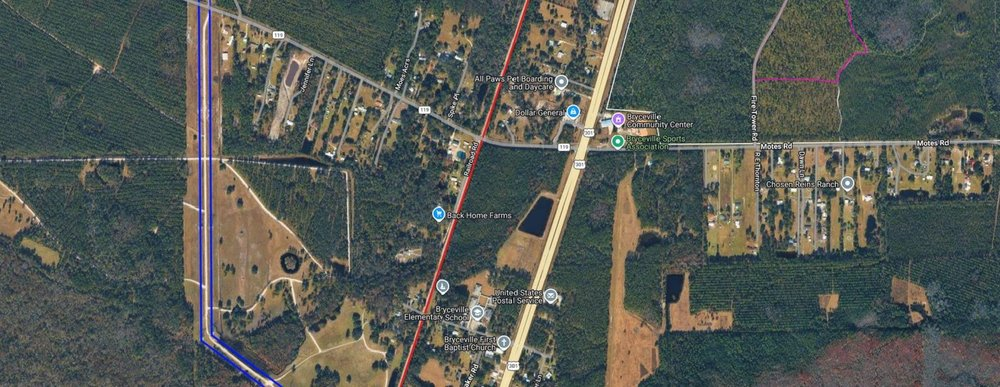
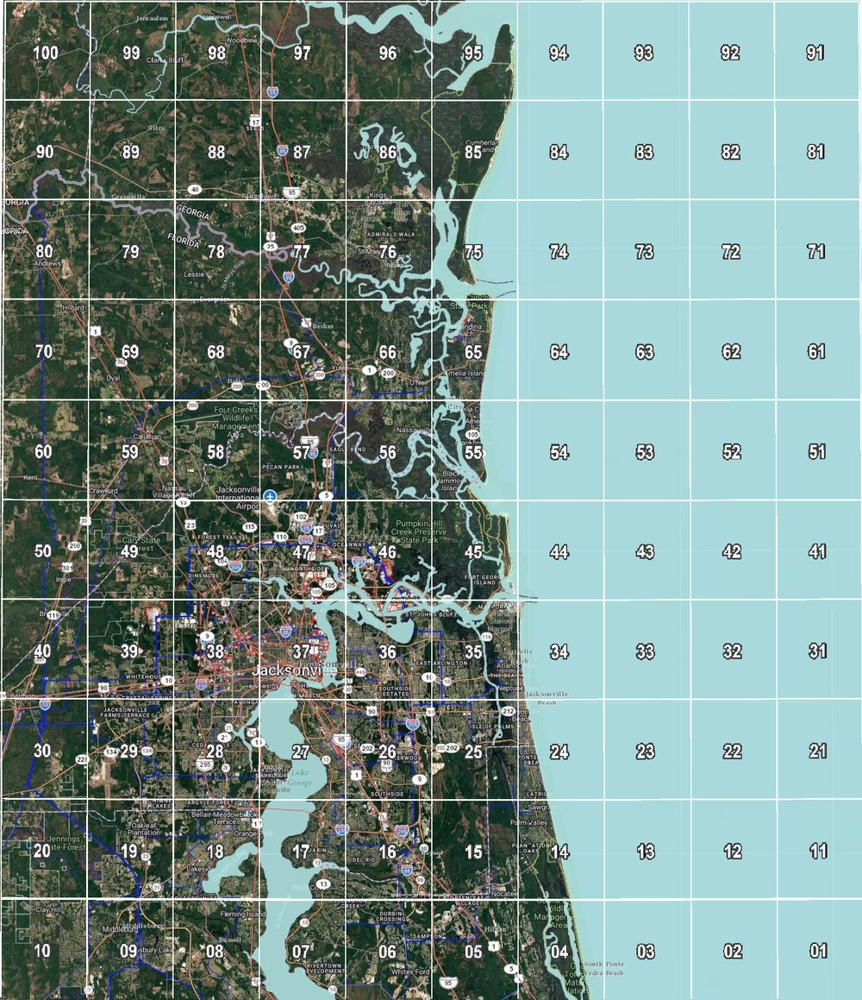
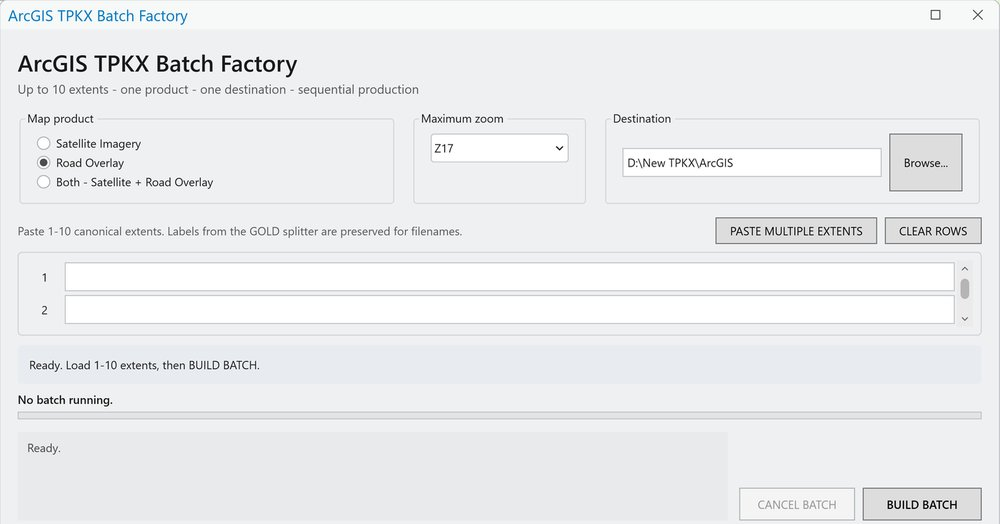
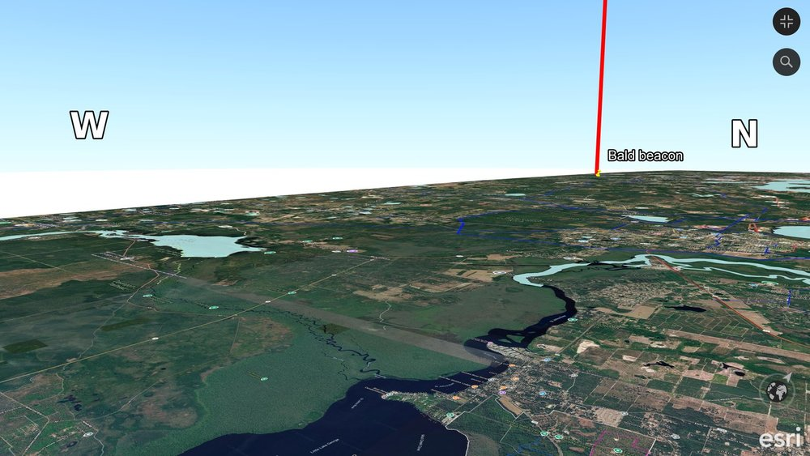
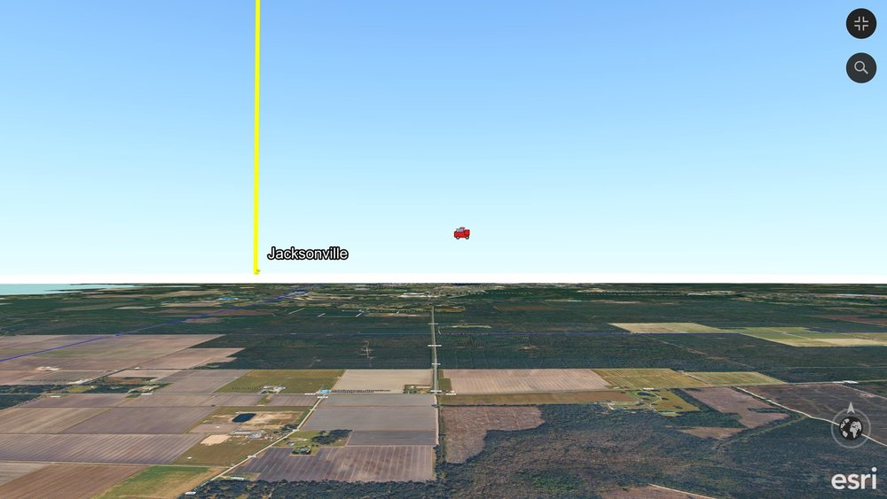
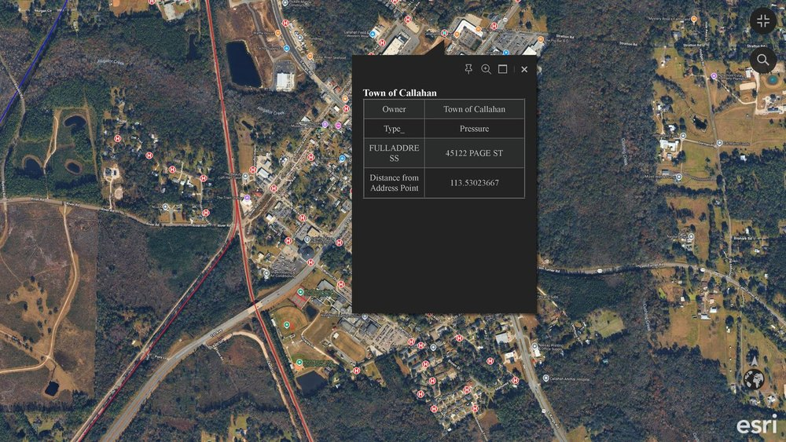
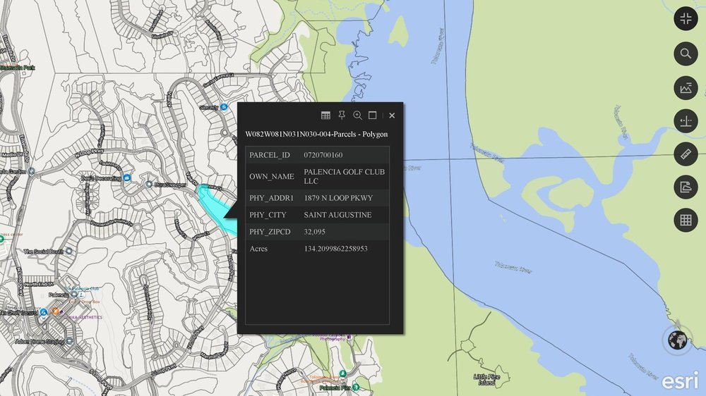
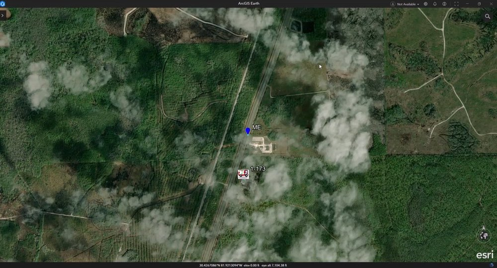

# ArcGIS Earth Unlocked

**Offline worlds, direct navigation, operational GIS, and programmable geographic objects - all inside ArcGIS Earth.**

This repository is the master front door for a family of independent tools and workflows built around **ArcGIS Earth**.

The projects began as separate solutions to separate problems: creating huge offline maps, carrying them into the field, interrogating parcels and public GIS data, navigating Earth with a joystick, and placing purposeful objects into the geographic world. Together they now form one coherent system.

> **The world is already built. We add the maps, movement, data, and objects.**

## Download the tools

Every tool is free. Click **⬇️ Download** to get the zip, and **📖 User manual** for step-by-step instructions. Click a picture to see that tool's page.

### **⬇️ [DOWNLOAD MBTILES -> TPKX CONVERTER v1.1](https://github.com/Jim-dc95811/QGIS-Mbtile-to-ArcGIS-Earth-TPKX/raw/main/mb2tpkx.zip)**
**📖 [User manual (PDF)](https://github.com/Jim-dc95811/QGIS-Mbtile-to-ArcGIS-Earth-TPKX/blob/main/mb2tpkx_User_Manual.pdf)**

Turn a QGIS raster MBTiles map into a TPKX that opens offline in ArcGIS Earth.

[](https://github.com/Jim-dc95811/QGIS-Mbtile-to-ArcGIS-Earth-TPKX)

*A converted Bryceville, Florida, map open offline in ArcGIS Earth. ▶️ [Watch the video](https://www.youtube.com/watch?v=C71n8TAByuE) (YouTube). [More about this tool](https://github.com/Jim-dc95811/QGIS-Mbtile-to-ArcGIS-Earth-TPKX).*

### **⬇️ [DOWNLOAD MASTER 4 GRID MAKER v3.1](https://github.com/Jim-dc95811/QGIS-Mbtile-to-ArcGIS-Earth-TPKX/raw/main/Master4_Grid_Maker.zip)**
**📖 [User manual (PDF)](https://github.com/Jim-dc95811/QGIS-Mbtile-to-ArcGIS-Earth-TPKX/blob/main/Master4_Grid_Maker_User_Manual.pdf)**

Split a 1-degree box into 100 numbered cells with exact extents and file names for large-area map production.

<a href="https://github.com/Jim-dc95811/QGIS-Mbtile-to-ArcGIS-Earth-TPKX"></a>

*A Master 4 box over Jacksonville, Florida, split into 100 numbered cells. ▶️ [Watch the video](https://www.youtube.com/watch?v=zNt-I4KgAy8) (YouTube). [More about this tool](https://github.com/Jim-dc95811/QGIS-Mbtile-to-ArcGIS-Earth-TPKX).*

### **⬇️ [DOWNLOAD ARCGIS TPKX BATCH FACTORY](https://github.com/Jim-dc95811/ArcGIS-Earth-Offline-Maps-Chartplotting/raw/main/downloads/TPKX_Batch_Factory_v1.zip)**
**📖 [User manual](https://github.com/Jim-dc95811/ArcGIS-Earth-Offline-Maps-Chartplotting/blob/main/docs/TPKX_BATCH_FACTORY.md)**

ArcGIS Pro add-in that builds up to 10 satellite or road-overlay TPKX packages in one batch, up to Z20.

[](https://github.com/Jim-dc95811/ArcGIS-Earth-Offline-Maps-Chartplotting)

*The Batch Factory window inside ArcGIS Pro. ▶️ [Watch the video](https://www.youtube.com/watch?v=KGckjaOu0hY) (YouTube). [More about this tool](https://github.com/Jim-dc95811/ArcGIS-Earth-Offline-Maps-Chartplotting).*

### **⬇️ [DOWNLOAD EARTHSTICK v1.1](https://github.com/Jim-dc95811/EarthStick/raw/main/releases/EarthStick_v1.1.zip)**
**📖 [User manual](https://github.com/Jim-dc95811/EarthStick/blob/main/docs/USER_GUIDE.md)**

Fly the real map in ArcGIS Earth with a Thrustmaster TCA Sidestick. Let go and it hovers.

[](https://github.com/Jim-dc95811/EarthStick)

*Flying low over the St. Johns River with a beacon and sky compass on the horizon. ▶️ [Watch the video](https://www.youtube.com/watch?v=5Wn14qlC7n4) (YouTube). [More about this tool](https://github.com/Jim-dc95811/EarthStick).*

### **⬇️ [DOWNLOAD ARCGIS EARTH OBJECT FACTORY v1.1](https://github.com/Jim-dc95811/ArcGIS-Earth-Object-Factory/raw/main/releases/ArcGIS_Earth_Object_Factory_v1.1.zip)**
**📖 [User manual](https://github.com/Jim-dc95811/ArcGIS-Earth-Object-Factory/blob/main/docs/OBJECT_FACTORY_USER_MANUAL.md)**

Put beacons, sky compass letters, icons and clickable objects into ArcGIS Earth, one at a time or in batches.

[](https://github.com/Jim-dc95811/ArcGIS-Earth-Object-Factory)

*A Jacksonville beacon and an airborne fire-truck object. [More about this tool](https://github.com/Jim-dc95811/ArcGIS-Earth-Object-Factory).*

### **⬇️ [DOWNLOAD POINTLAYER v1.4](https://github.com/Jim-dc95811/Point-Maps/raw/main/releases/PointLayer_v1.4.zip)**
**📖 [User manual](https://github.com/Jim-dc95811/Point-Maps/blob/main/docs/USER_GUIDE.md)**

Turn a public ArcGIS point layer, such as fire hydrants, into a clean offline KMZ or GeoJSON overlay.

[](https://github.com/Jim-dc95811/Point-Maps)

*Nassau County hydrants around Callahan, Florida, with one hydrant's details open. [More about this tool](https://github.com/Jim-dc95811/Point-Maps).*

### **⬇️ [DOWNLOAD PARCEL100 v1.5](https://github.com/Jim-dc95811/Parcel100/raw/main/downloads/Parcel100_v1.5.zip)**
**📖 [User manual](https://github.com/Jim-dc95811/Parcel100/blob/main/USER_MANUAL.md)**

Build up to 100 offline parcel files for one Master 4 box. Click a parcel to see the owner, address and acres.

[](https://github.com/Jim-dc95811/Parcel100)

*A St. Johns County parcel with its owner, address and acres. ▶️ [Watch the video](https://www.youtube.com/watch?v=_hMB_TOODOQ) (YouTube). [More about this tool](https://github.com/Jim-dc95811/Parcel100).*

### **⬇️ [DOWNLOAD PRAVE / ME TRACKER v1.2](https://github.com/Jim-dc95811/ArcGIS-Earth-Offline-Maps-Chartplotting/raw/main/downloads/PRAVE_ME_Tracker_v1.zip)**
**📖 [User manual](https://github.com/Jim-dc95811/ArcGIS-Earth-Offline-Maps-Chartplotting/blob/main/docs/PRAVE_ME_TRACKER.md)**

Show your own position (ME) and other radio-tracked units live in ArcGIS Earth from a Raveon PRAVE/RMC radio.

[](https://github.com/Jim-dc95811/ArcGIS-Earth-Offline-Maps-Chartplotting)

*ME and unit 1-173 drawn live in ArcGIS Earth. ▶️ [Watch the video](https://www.youtube.com/watch?v=JKWJmEIBP_I) (YouTube). [More about this tool](https://github.com/Jim-dc95811/ArcGIS-Earth-Offline-Maps-Chartplotting).*

## The system

```text
                    ARCGIS EARTH UNLOCKED

     FOUNDATION              OPERATIONAL DATA
  offline TPKX worlds      parcels / public points
          |                         |
          +------------+------------+
                       |
                       v
                 ARCGIS EARTH
                       ^
                       |
         +-------------+-------------+
         |                           |
      NAVIGATION                  OBJECTS
      EarthStick              Object Factory
         |                   beacons / icons /
         |                   sky compass / links
         +-------------+-------------+
                       |
                       v
             interactive real geography
```

## Start with what you want to do

| I want to... | Start here |
|---|---|
| Make large offline zoomable ArcGIS Earth maps | [QGIS MBTiles -> ArcGIS Earth TPKX](https://github.com/Jim-dc95811/QGIS-Mbtile-to-ArcGIS-Earth-TPKX) |
| Use the earlier offline-map / chartplotting / mobile workflow | [ArcGIS Earth Offline Maps & Chartplotting](https://github.com/Jim-dc95811/ArcGIS-Earth-Offline-Maps-Chartplotting) |
| Fly and navigate ArcGIS Earth with a joystick | [EarthStick](https://github.com/Jim-dc95811/EarthStick) |
| Put beacons, sky objects, icons, information, or object sets into Earth | [ArcGIS Earth Object Factory](https://github.com/Jim-dc95811/ArcGIS-Earth-Object-Factory) |
| Turn public ArcGIS point services into offline KMZ/GeoJSON layers | [Point Maps / PointLayer](https://github.com/Jim-dc95811/Point-Maps) |
| Build offline clickable parcel layers | [Parcel100](https://github.com/Jim-dc95811/Parcel100) |

## 1. Foundation maps

### QGIS MBTiles -> ArcGIS Earth TPKX

Repository: [QGIS-Mbtile-to-ArcGIS-Earth-TPKX](https://github.com/Jim-dc95811/QGIS-Mbtile-to-ArcGIS-Earth-TPKX)

Primary role:

> **Build the durable offline world.**

The converter turns compatible raster MBTiles into TPKX for fast offline use in ArcGIS Earth. The surrounding Master 4 workflow provides deterministic geographic organization for large-area production.

Typical use:
- wide-area Z17/Z18 overview
- local Z20 detail
- imagery, road, hybrid, or other authorized raster tile sources
- ArcGIS Earth desktop/mobile offline viewing

### ArcGIS Earth Offline Maps & Chartplotting

Repository: [ArcGIS-Earth-Offline-Maps-Chartplotting](https://github.com/Jim-dc95811/ArcGIS-Earth-Offline-Maps-Chartplotting)

This preserves the earlier ArcGIS Pro/TPKX production (the TPKX Batch Factory), mobile/offline, chartplotting, and PRAVE / ME field-tracker work. Its production extents now come from the Master 4 Grid Maker. It remains useful operational and historical tooling rather than being folded into the newer MBTiles converter.

## 2. Navigation

### EarthStick

Repository: [EarthStick](https://github.com/Jim-dc95811/EarthStick)

Core idea:

> **Fly the real map.**

EarthStick gives direct joystick control to the ArcGIS Earth camera through the Automation API.

Neutral controls create a stable working state:

> **Stop. Hover. Think. Then move.**

EarthStick changes the relationship to the viewer: instead of merely operating a map, the user can move through the geographic world directly.

## 3. Objects and authoring

### ArcGIS Earth Object Factory

Repository: [ArcGIS-Earth-Object-Factory](https://github.com/Jim-dc95811/ArcGIS-Earth-Object-Factory)

Object Factory is the active object-authoring and experimentation center.

Current v1.1 primitives:
- one-off PNG geographic objects
- 11 built-in presets
- batch object sets
- Sky Compass
- Earth Beacon
- optional tethers and labels
- clickable information
- optional web links
- automatic PNG normalization for lean KMZ files

Core information flow:

> **See it -> recognize it -> click it -> understand it.**

Core connectivity rule:

> **Offline object = useful by itself. Connected object = potentially unlimited extension.**

Future object work can begin there: camera/viewpoint launchers, scenario logic, 3D models, classroom/training object sets, or other geographic-object experiments.

## 4. Operational GIS data

### Point Maps / PointLayer

Repository: [Point-Maps](https://github.com/Jim-dc95811/Point-Maps)

Primary role:

> **Turn a public ArcGIS point service into a clean offline layer.**

PointLayer reads public FeatureServer/MapServer point layers, lets the operator choose useful attributes, and produces offline KMZ/GeoJSON output.

Examples include hydrants, fire stations, shelters, towers, gates, AEDs, hospitals, and helipads.

### Parcel100

Repository: [Parcel100](https://github.com/Jim-dc95811/Parcel100)

Primary role:

> **Add clickable property intelligence beside the imagery.**

Parcel100 creates manageable offline GeoJSON parcel cells from public ArcGIS parcel services.

Useful pairing:

```text
TPKX    = what the ground looks like
GeoJSON = what the parcel database knows about the ground
```

## 5. Architecture rule

Keep expensive durable geography separate from frequently changing information.

> **Foundation = stable geography**  
> **Layers = changing information**

Foundation examples:
- imagery
- roads
- terrain
- TPKX

Changeable layers and objects:
- parcels
- hydrants
- offices
- photos
- clues
- hazards
- beacons
- staging
- landing zones
- scenario objectives
- sky objects

Do not rebuild a massive foundation map because one operational object changed.

## 6. Offline first

A recurring result of this project family is that the strongest pieces do not require internet at the incident, classroom, or field location:

- TPKX foundation maps
- EarthStick
- Earth Beacon
- Sky Compass
- Object Factory KML/KMZ
- local photos/instructions
- Parcel100 GeoJSON
- PointLayer KMZ/GeoJSON

When internet exists, objects can extend outward through links to live cameras, Street View, weather, incident dashboards, agency pages, training resources, equipment manuals, and other web content.

Online services are enhancements, not the foundation.

## 7. Basemaps can be part of the problem

ArcGIS Earth can change the visual language without changing geographic position.

A training or exploration problem may require the operator to realize that the current map is the wrong tool:
- imagery for visual recognition
- street maps for names/routes
- topo for drainage/ridges/elevation
- parcels for ownership/access
- historical maps for change
- live overlays for current conditions

> **The map is not the answer. Choosing the right map is part of the answer.**

## 8. Public safety and classroom directions

The same architecture supports very different uses.

Public safety:
- pre-incident familiarization
- parcel/ownership context
- hydrants/water
- staging/LZ/egress exercises
- facility recognition
- offline incident mapping

Classroom:
- local geography
- bird/tree/animal identification
- history scavenger hunts
- coordinate literacy
- basemap problem solving
- student-authored object worlds

The common principle is accessibility:

> **Do not make the user learn GIS before they can use geography.**

## 9. Project boundaries

Each repository keeps one clear job. The umbrella explains the relationship; it does not replace the specialized tools.

```text
Foundation maps  -> what the world looks like
Operational data -> what databases know about the world
EarthStick       -> how the user moves through the world
Object Factory   -> what intentional objects and meaning are placed in the world
ArcGIS Earth     -> renderer / common environment
```

## 10. Independence

These are independent projects. ArcGIS, ArcGIS Pro, and ArcGIS Earth are Esri products and trademarks. These repositories are not Esri products or official Esri distributions.

Third-party imagery, data, icons, services, URLs, and other content remain subject to their respective rights, terms, accuracy, and suitability requirements.

## Project mission

> **Create new map makers.**

The goal is not to bury ordinary users in GIS workflow. It is to make real geography accessible enough that firefighters, resource staff, students, teachers, field operators, and other non-specialists can create and use useful maps themselves.
